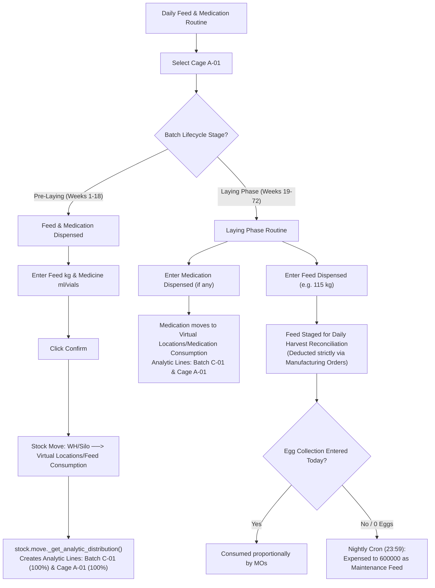
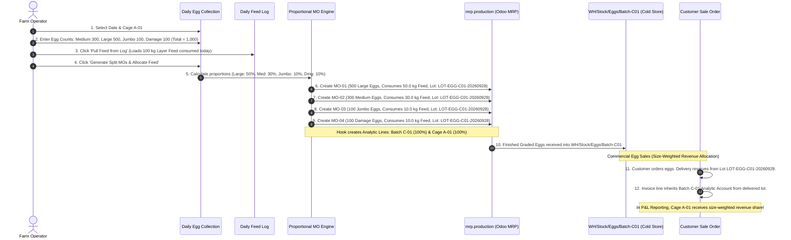
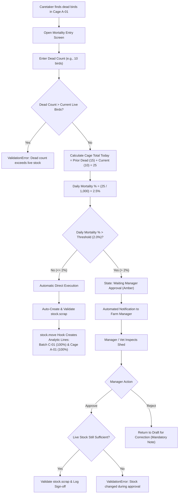

# Top Farm: End-to-End Architecture & 4 Core Operational Workflows

**Comprehensive Technical Design, Odoo 19 Native Valuation & Analytic Engine Specifications**  
*Document Version:* 4.0 (Production Blueprint - Reconciled & Codebase-Verified)  
*Target System:* Odoo 19.0 (Enterprise / Community)  
*Client:* Top Farm (Commercial Poultry Layer Operations)  
*Scope:* Modules 1 through 4 (`top_farm_core`, `top_farm_operations`, `top_farm_mortality`, `top_farm_dashboard`)

---

## Table of Contents
1. [Core Architectural Breakthrough: The Single Odoo 19 stock.move Hook](#1-core-architectural-breakthrough-the-single-odoo-19-stockmove-hook)
2. [Odoo 19 Valuation & Configuration Pre-requisites](#2-odoo-19-valuation--configuration-pre-requisites)
3. [Reconciled Operational Rules & Edge Cases](#3-reconciled-operational-rules--edge-cases)
4. [Workflow 1: Farm, Batch & Cage Setup + Chick Allocation](#4-workflow-1-farm-batch--cage-setup--chick-allocation)
5. [Workflow 2: Daily Feeding & Medication Logging](#5-workflow-2-daily-feeding--medication-logging)
6. [Workflow 3: Graded Egg Harvest, Proportional MO Splitting & Size-Weighted Revenue](#6-workflow-3-graded-egg-harvest-proportional-mo-splitting--size-weighted-revenue)
7. [Workflow 4: Bird Mortality, Anti-Bypass Daily Safeguards & Stock Scrap](#7-workflow-4-bird-mortality-anti-bypass-daily-safeguards--stock-scrap)
8. [Operational Dashboards, Historical KPI Integrity & Financial P&L](#8-operational-dashboards-historical-kpi-integrity--financial-pl)
9. [Accountant Decision Framework: Pre-Laying Capitalization vs Direct Expense](#9-accountant-decision-framework-pre-laying-capitalization-vs-direct-expense)
10. [Final Implementation Effort Estimate (120–130 Hours)](#10-final-implementation-effort-estimate-120130-hours)

---

## 1. Core Architectural Breakthrough: The Single Odoo 19 stock.move Hook

### Why Earlier MO Analytic Claims Were Wrong
In Odoo 19, `mrp.production` has **no native `analytic_distribution` field**. Standard Odoo routes MO analytics exclusively through `project_mrp_account`, where stock moves fetch analytics from the linked project:
```python
# Standard Odoo 19 project_mrp_account/models/stock_move.py
def _get_analytic_distribution(self):
    distribution = self.raw_material_production_id.project_id._get_analytic_distribution()
    return distribution or super()._get_analytic_distribution()
```
Creating an Odoo Project for every single cage is bloated, confusing for farm workers, and requires unnecessary master data overhead.

### The Elegant Odoo 19 Solution: One Hook to Rule Them All
In `stock_account/models/stock_move.py`, Odoo 19 defines the base extension point:
```python
def _get_analytic_distribution(self):
    return {}
```
When any stock move is validated, Odoo 19’s `_action_done()` invokes `_create_analytic_move()` (lines 181, 214, 589–619), which reads `_get_analytic_distribution()` and creates native `account.analytic.line` records linked to the stock move.

In `top_farm_core`, we override `stock.move._get_analytic_distribution()` **once**:

```python
class StockMove(models.Model):
    _inherit = 'stock.move'

    def _get_analytic_distribution(self):
        # 1. Call super() first so any explicit Project or higher-priority distribution wins
        res = super()._get_analytic_distribution()
        if res:
            return res

        # 2. Check if source or destination location is a cage sublocation
        cage_loc = False
        if self.location_id.farm_hierarchy_level == 'cage':
            cage_loc = self.location_id
        elif self.location_dest_id.farm_hierarchy_level == 'cage':
            cage_loc = self.location_dest_id

        # 3. If move is raw material consumed by an Egg Harvest MO, get cage from the collection
        if not cage_loc and self.raw_material_production_id and self.raw_material_production_id.farm_collection_id:
            cage_loc = self.raw_material_production_id.farm_collection_id.cage_location_id

        # 4. If a cage was identified, return independent 100% Batch + 100% Cage distribution
        if cage_loc:
            return cage_loc.get_analytic_distribution_for_cage()

        return {}
```

### Why This Simplifies the Whole System:
This single override of 15 lines of code natively handles:
1. **Pre-laying feed & medication transfers** (Source: Silo $\rightarrow$ Dest: Feed Consumption Location).
2. **Laying-phase MO raw feed consumption** (`raw_material_production_id` linked to Egg Collection).
3. **Bird mortality scrap moves** (Source: Cage Sublocation $\rightarrow$ Dest: Virtual Scrap Location).
4. **Nightly unharvested feed fallback moves** (Source: Silo $\rightarrow$ Dest: Feed Consumption Location).

### Critical Accounting Rule: Analytic Lines vs Journal Items
* In Odoo 19, `stock.move._get_account_move_line_vals()` builds stock journal entries **without** `analytic_distribution`.
* The tags are stored as separate `account.analytic.line` records linked directly to the `stock.move`.
* **Important:** We do **not** inject `analytic_distribution` into `account.move.line` for stock moves. Doing so would cause Odoo's accounting engine to generate a duplicate set of analytic lines, doubling costs in profitability reports.

---

## 2. Odoo 19 Valuation & Configuration Pre-requisites

### The Odoo 19 Valuation Reality
1. **No `stock.valuation.layer`:** In Odoo 19, `stock.valuation.layer` has been deprecated. Valuation is stored directly on `stock.move` (`value` field) and `product.value`.
2. **Default to Periodic Valuation:** In Odoo 19, `res_company.inventory_valuation` defaults to `'periodic'` (`res_company.py:35`). In periodic mode, Odoo does not post individual move journal entries.
3. **The `_should_create_account_move` Rule:** Odoo 19's `stock.move._should_create_account_move()` creates real-time journal entries **only if**:
   * `product_id.valuation == 'real_time'` (Perpetual inventory valuation).
   * `location.valuation_account_id` is configured on either the source or destination location.

### Mandatory Master Setup Checklist:
* **Product Categories set to Perpetual (`real_time`):**
  * `Poultry Feed` (Automated Valuation)
  * `Veterinary Medication & Vaccines` (Automated Valuation)
  * `Live Birds / Layers` (Automated Valuation)
  * `Graded Table Eggs` (Automated Valuation)
* **Location Valuation Accounts:**
  * Location `Virtual Locations/Feed Consumption` $\rightarrow$ `valuation_account_id` = `600000 Feed Expense`.
  * Location `Virtual Locations/Medication Consumption` $\rightarrow$ `valuation_account_id` = `610000 Vet & Medication Expense`.
  * Location `Virtual Locations/Scrapped` $\rightarrow$ `valuation_account_id` = `630000 Mortality Loss`.

---

## 3. Reconciled Operational Rules & Edge Cases

### A. Automatic Sales Revenue Traceability by Batch
* **Cold-Store Batch Sublocations:** In the cold room (`WH/Stock/Eggs`), eggs are segregated into sublocations: `WH/Stock/Eggs/Batch-C01`, `WH/Stock/Eggs/Batch-C02`.
* **Egg Batch Lot:** Each auto-split MO tags produced eggs with a lot number identifying the batch (e.g. `LOT-EGG-C01-20260928`).
* **Automatic Invoice Inheritance:** When a sales delivery order (`stock.picking`) reserves and delivers eggs from that batch lot/sublocation, the customer invoice line **automatically inherits the Batch Analytic Account**. Sales staff do not need to guess or manually tag batches.

### B. Size-Weighted Cage Revenue Allocation Formula
To evaluate Cage P&L fairly, revenue is distributed based on the specific market value of each egg grade:
$$\text{Cage Revenue} = \sum_{s \in \{\text{Medium, Large, Jumbo, Damage}\}} \left[ \text{Batch Revenue}_s \times \left(\frac{\text{Cage Production of Size } s}{\text{Batch Production of Size } s}\right) \right]$$
* *Example:* A cage producing mostly Jumbo eggs (\$5.00/dozen) receives significantly higher revenue than a cage producing mostly Damage eggs (\$0.50/dozen).
* *Timing Variance:* Compares revenue realized in the period with production share in that same period. Cold-store inventory carryover over month-end is recognized as standard finished-goods inventory timing variance.

### C. Fallback for Unharvested Laying Feed (Preventing Stranded Inventory)
* If feed is dispensed to a cage during the laying phase, but no eggs are harvested that day (or 0 eggs are entered), the feed would normally stay stuck.
* **Nightly Cron Action (`cron_reconcile_unharvested_feed` at 23:59):**  
  Any laying feed staged today with no MO is automatically written off to `Virtual Locations/Feed Consumption` under `600000 Feed Expense` tagged as *Flock Maintenance / Zero-Egg Feed*. Inventory never leaks.

### D. Laying-Phase Medicine Accounting
* Medication given during the laying phase is **expensed directly to `610000`**, NOT added to Manufacturing Orders.
* Keeps eggs free from artificial cost inflation and directly penalizes the sick cage's profitability.

### E. Anti-Bypass Mortality Approval Controls
* **Cumulative Daily Check:** Prevents workers from bypassing manager approval by splitting 50 dead birds into five entries of 10:
  $$\text{Daily Cage Mortality \%} = \left(\frac{\text{Today's Prior Dead Birds} + \text{Current Entry Dead Birds}}{\text{Current Live Population}}\right) \times 100$$
  *If this sum exceeds `daily_mortality_threshold_pct` (default: 2.0%), approval is mandatory.*
* **Approval Re-Validation:** When the manager clicks "Approve", the system re-checks that `dead_bird_count <= current_live_birds`.
* **Reject Action:** Returns the record to `draft` for correction, requiring a mandatory rejection reason in chatter.

### F. Transition to Laying Phase
* Controlled by a dedicated button on the Batch form: **"Start Laying Phase"** (restricted to Farm Managers).
* Automated to-do notification triggered at Week 18 (`flock_age_weeks >= 18.0`).

---

## 4. Workflow 1: Farm, Batch & Cage Setup + Chick Allocation

```mermaid
sequenceDiagram
    autonumber
    actor Admin as Farm Admin
    participant Loc as stock.location (Core)
    participant PO as Purchase Order
    participant Quant as stock.quant (Inventory)
    participant Trf as Internal Transfer

    Admin->>Loc: 1. Create WH/Farm 1 (farm_hierarchy_level='farm')
    Admin->>Loc: 2. Create Batch C-01 (farm_hierarchy_level='batch', Arrival: 01/01/2026, Stage='pre_laying')
    Admin->>Loc: 3. Create Cages A-01..A-20 (farm_hierarchy_level='cage', parent=Batch C-01)
    Note over Loc: System auto-computes parent_batch_location_id = Batch C-01

    Admin->>PO: 4. Purchase 20,000 Pullet Chicks from Hatchery
    PO->>Quant: 5. Receive into Batch C-01 under Hatchery Lot LOT-C01-2026
    Note over Quant: Batch C-01 Live Birds = 20,000 on hand

    Admin->>Trf: 6. Internal Transfer: Move 1,000 chicks to Cage A-01 (Retaining Lot LOT-C01-2026)
    Trf->>Quant: 7. Deduct 1,000 from Batch; Add 1,000 to Cage A-01
    Note over Loc,Quant: Cage A-01 Form displays Live Birds: 1,000 (Batch lot retained!)
```

### Visual UI Representation: Location Form

```text
┌────────────────────────────────────────────────────────────────────────────────────────────────────────┐
│  Stock Location / Cage A-01                                                                            │
│                                                                        ┌───────────────┐  ┌──────────┐ │
│                                                                        │ [ 1,000] Birds│  │ Putaway  │ │
│                                                                        └───────────────┘  └──────────┘ │
│  Location Name:   [ Cage A-01                ]                                                         │
│  Parent Location: [ WH/Farm 1/Batch C-01     ]                                                         │
│                                                                                                        │
│  ▼ Poultry Farm Operations & Analytics                                                                │
│  ┌─ Hierarchy Classification ─────────────────────┐ ┌─ Flock Lifecycle & Analytics ───────────────────┐│
│  │ Farm Hierarchy Level: [ Cage Sublocation     ▼ ]│ │ Parent Batch:   [ Batch C-01          (auto) ] ││
│  │ Usage:                [ Internal Location    ▼ ]│ │ Analytic Account:[ Cage A-01 Analytic Account ▼ ]││
│  └────────────────────────────────────────────────┘ └─────────────────────────────────────────────────┘│
└────────────────────────────────────────────────────────────────────────────────────────────────────────┘
```

---

## 5. Workflow 2: Daily Feeding & Medication Logging



---

## 6. Workflow 3: Graded Egg Harvest, Proportional MO Splitting & Size-Weighted Revenue



### Visual UI Representation: Daily Egg Collection Screen

```text
┌────────────────────────────────────────────────────────────────────────────────────────────────────────┐
│  Daily Graded Egg Collection / EGG/2026/00142                         [ Generate Split MOs ] [ Cancel ]│
│  Reference: [ EGG/2026/00142          ]  Date: [ 28/09/2026 ]  Status: [ Draft ]                       │
│  Batch:     [ Batch C-01              ]  Cage: [ Cage A-01  ]  Storage:[ WH/Stock/Eggs/Batch-C01      ]│
│                                                                                                        │
│  Flock KPI Snapshot:                                                                                   │
│  Live Birds (Snapshot): [ 1,000 Birds ]  Hen-Day Rate: [ 100.0% ]  FCR: [ 1.20 kg/dozen ]             │
│                                                                                                        │
│  ▼ Graded Egg Collection Quantities (Units)                                                           │
│  ┌─ Medium & Large ───────────────────────────────┐ ┌─ Jumbo & Damage ────────────────────────────────┐│
│  │ Egg - Medium: [  300 ] units                   │ │ Egg - Jumbo:  [  100 ] units                    ││
│  │ Egg - Large:  [  500 ] units                   │ │ Egg - Damage: [  100 ] units                    ││
│  └────────────────────────────────────────────────┘ └─────────────────────────────────────────────────┘│
│  Total Eggs Harvested: 1,000 units                                                                     │
│                                                                                                        │
│  ▼ Feed Consumed (Components for MO)                           [ Pull Feed from Daily Log ]            │
│  ┌──────────────────────┬────────────────────────┬─────────────┬──────────────────────────────────────┐│
│  │ Feed Product         │ Source Silo            │ Consumed kg │ Allocation Rule                      ││
│  ├──────────────────────┼────────────────────────┼─────────────┼──────────────────────────────────────┤│
│  │ Layer Mash Feed A    │ WH/Feed Silo 1         │   100.00 kg │ Proportional to Egg Share (Zero Res) ││
│  └──────────────────────┴────────────────────────┴─────────────┴──────────────────────────────────────┘│
└────────────────────────────────────────────────────────────────────────────────────────────────────────┘
```

---

## 7. Workflow 4: Bird Mortality, Anti-Bypass Daily Safeguards & Stock Scrap



---

## 8. Operational Dashboards, Historical KPI Integrity & Financial P&L

### Biological KPI Calculation Engine:
1. **Hen-Day Egg Production Rate (%):**
   $$\text{Hen-Day Rate} = \left(\frac{\text{Daily Eggs Collected}}{\text{confirmed\_live\_bird\_count}}\right) \times 100$$
   *Using the stored snapshot ensures that when birds die weeks later, historical reports still correctly show that day's true hen performance.*
2. **Feed Conversion Ratio (FCR):**
   $$\text{FCR (kg per dozen)} = \frac{\text{Total Feed Consumed (kg)}}{(\text{Total Eggs Produced} / 12)}$$
3. **Daily Feed Intake:**
   $$\text{Intake (g/bird/day)} = \frac{\text{Total Feed Consumed (kg)} \times 1000}{\text{confirmed\_live\_bird\_count}}$$

---

### Reconciled Mortality Report by Batch & Cage (Corrected Math)
*Flock size:* 20,000 birds total across 20 cages (1,000 birds/cage).

```text
┌───────────────────────────────────────────────────────────────────────────────────────────────────────┐
│  Poultry Mortality Analysis Report                                    [ Pivot ▼ ]  [ Measures: Dead ] │
├─────────────────────────┬──────────────┬──────────────┬───────────────┬──────────────┬────────────────┤
│ Location / Flock        │ Heat Stress  │ Disease      │ Sudden Death  │ Total Dead   │ Mortality Rate │
├─────────────────────────┼──────────────┼──────────────┼───────────────┼──────────────┼────────────────┤
│ Batch C-01 (Total)      │     45       │     12       │      18       │     75       │    0.375 %     │
│  ├─ Cage A-01           │      2       │      1       │       2       │      5       │     0.50 %     │
│  ├─ Cage A-02           │     38       │      2       │       4       │     44       │     4.40 % (!) │
│  └─ Cage A-03           │      5       │      9       │      12       │     26       │     2.60 %     │
└─────────────────────────┴──────────────┴──────────────┴───────────────┴──────────────┴────────────────┘
```
*(Mathematical check: $75\text{ dead} / 20,000\text{ birds} = \mathbf{0.375\%}$ exact. Cage A-02 at $4.40\%$ immediately flags the failed ventilation fan).*

---

### Reconciled Batch & Cage Profitability Report (Including Mortality Loss)

| Financial Metric | Batch C-01 (Total) | Cage A-01 | Cage A-02 | Variance / Notes |
|---|:---:|:---:|:---:|---|
| **Egg Sales Revenue (Size-Weighted)** | **+\$5,600.00** | **+\$3,600.00** | **+\$2,000.00** | Cage A-01 produced 80% Large/Jumbo |
| Feed Consumed (MO Raw Material) | -\$2,000.00 | -\$1,000.00 | -\$1,000.00 | Both cages consumed 2,000 kg feed |
| Veterinary & Medication Expense | -\$120.00 | \$0.00 | -\$120.00 | Antibiotics given strictly to Cage A-02 |
| **Mortality Loss (`630000`)** | **-\$150.00** | **-\$10.00** (5 dead) | **-\$88.00** (44 dead) | **Deducted directly from margin!** |
| **Gross Operating Profit** | **+\$3,330.00** | <b style="color:green;">+\$2,590.00</b> | <b style="color:orange;">+\$792.00</b> | **Cage A-01 is 3.3× more profitable** |
| **Operating Margin %** | **59.5%** | **71.9%** | **39.6%** | Cage A-02 margin severely depressed |

---

## 9. Accountant Decision Framework: Pre-Laying Capitalization vs Direct Expense

Before go-live, the Top Farm Chief Accountant must choose one of two standard agricultural accounting treatments for the pre-laying phase (Weeks 1 to 18):

```
                                [ Pre-Laying Feed & Medication ]
                                                │
                     ┌──────────────────────────┴──────────────────────────┐
                     ▼                                                     ▼
           [ Option A: Direct Expense ]                         [ Option B: Capitalization ]
       • Feed & Med expensed as incurred                    • Feed & Med accumulated into Asset:
         (Debit: 600000 Feed / 610000 Med)                    Livestock Biological Asset (141000)
       • Bird balance-sheet value stays at $2.00            • At Week 18, bird value increases to $7.50
       • Mortality write-off = $2.00 per dead bird          • Mortality write-off = $7.50 per dead bird
       • Simpler; highly conservative accounting            • Accords strictly with IAS 41 (Agriculture)
```

*Note: The current workflow baseline is built on **Option A (Direct Expense)**. If Option B is selected by the accountant, only the account linked to `Virtual Locations/Feed Consumption` changes from `600000` to `141000`—the workflow screens and user steps remain identical.*

---

## 10. Final Implementation Effort Estimate (120–130 Hours)

Thanks to the single Odoo 19 `stock.move._get_analytic_distribution()` override replacing three separate hooks, development hours remain clean and realistic:

```text
TOP FARM - FINAL ODOO ERP IMPLEMENTATION ESTIMATE

1. Batch & Cage Hierarchy & Single stock.move Hook (Core):         11 - 12 hrs
   (Includes single stock.move._get_analytic_distribution override & location validation)
2. Daily Feed & Medicine Log Screen (Operations/Inventory):        14 - 15 hrs
   (Includes pre-laying direct expense & nightly cron for unharvested feed)
3. Daily Graded Egg Collection Screen (Operations/MRP):            12 - 13 hrs
   (Includes 4-bucket grid, snapshot bird count, and egg batch lot generation)
4. Auto-Split MOs with Proportional Feed Allocation (Custom MRP):  25 - 27 hrs
   (Includes proportional math, rounding reconciliation, and cold-store lots)
5. Mortality Entry, Daily Cumulative Guards & Manager Approval:    12 - 13 hrs
   (Includes daily threshold sum check, approval re-validation, and scrap hook)
6. Poultry KPI Dashboards, Mortality & Size-Weighted P&L Reports:  17 - 18 hrs
   (Includes Hen-Day snapshot, kg/dozen FCR, size-weighted revenue, and mortality pivot)
--------------------------------------------------------------------------------
Development Subtotal:                                              91 - 98 hrs

End-to-End Integration Testing & QA:                               12 - 13 hrs
User Acceptance Testing (UAT) Support & Adjustments:               10 - 11 hrs
Deployment, Master Data Setup & System Handover:                    7 - 8 hrs
--------------------------------------------------------------------------------
TOTAL ESTIMATED EFFORT:                                           120 - 130 hrs
(Estimated Timeline: ~3 weeks / 15 to 16 working days)
```
