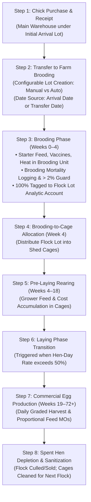
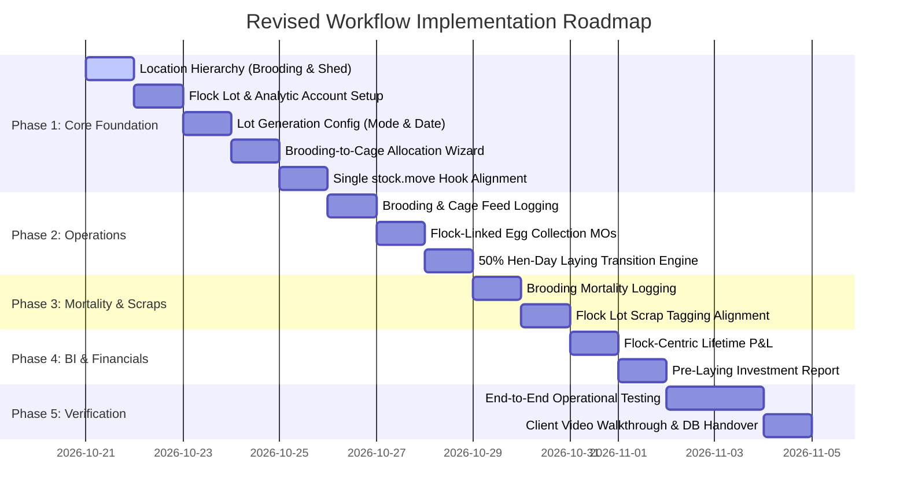

# Top Farm: Revised Functional Implementation Plan

**Target System:** Odoo 20.0 Enterprise  
**Project:** Top Farm Commercial Poultry Layer Operations  
**Document Purpose:** Complete functional design and operational implementation plan for the revised poultry workflow following management review with Mohamed Safran.  
*(Note: This document focuses purely on business logic, operational workflows, configuration options, and functional design without code blocks).*

---

## 1. Executive Summary & Core Architectural Shift

The initial implementation configured poultry operations around the concept that a "Batch" was a physical `stock.location` in Odoo's warehouse hierarchy. In the client review, Top Farm management clarified that physical farm infrastructure (estates, sheds, cages) is permanent, while a **Batch** is a dynamic biological cohort of birds (a Flock Lot) that moves through those physical assets.

```
┌────────────────────────────────────────────────────────────────────────────────────────┐
│                          CORE ARCHITECTURAL REALIGNMENT                                │
├───────────────────────────────┬────────────────────────────────────────────────────────┤
│ Previous (Flawed) Assumption  │ Physical Location = Batch (Farm -> Batch -> Cage)      │
│ Correct Real-World Reality    │ Physical Infrastructure (Farm -> Brooding / Cages)     │
│                               │ is PERMANENT.                                          │
│                               │ Flock Batch is a DYNAMIC LOT (stock.lot) that rotates  │
│                               │ through physical cages over a 2 to 2.5-year lifecycle. │
└───────────────────────────────┴────────────────────────────────────────────────────────┘
```

### Key Functional Pillars:
1. **Flock Traceability via Lot Numbers:** Batches are tracked as unique lot numbers (e.g., `IHL-19-10-2026`) holding chick arrival date, age in weeks, lifecycle stage, and dedicated analytic accounts. Physical cages are reused across multiple flocks over time.
2. **Configurable Lot Creation Modes (Approach A vs. Approach B):** When chicks are transferred from the Main Warehouse to an estate's Brooding Nursery, the system supports both **Manual Entry (Standard Odoo)** and **Automated Lot Generation (Configurable rule with Arrival Date vs. Transfer Date selection)**.
3. **The Brooding (Nursery) Phase (Weeks 0–4):** Day-old chicks do not go into laying cages immediately. They spend their first 3 to 4 weeks in a heated brooding area where starter feed, vaccinations, initial health care, and brooding mortality logging take place. Cage allocation happens only at Week 4.
4. **Flock-Centric Analytic Account Routing:** All brooding activities (feed, vaccines, mortality scraps) tag **100% to the Flock Lot's Analytic Account** without requiring a cage. Once birds move to cages at Week 4, costs tag to both the Flock Lot account and the specific Cage account.
5. **Pre-Laying Cost Accumulation:** Chicks arrive at approximately LKR 150 each. Over the 4 to 5 months of pre-laying rearing, feed, vaccines, debeaking, and operational care accumulate another LKR 1,000 to LKR 1,150, creating a point-of-lay hen valued at LKR 1,200 to LKR 1,300. Management monitors this cumulative investment per bird until egg production reaches 50%.

---

## 2. End-to-End Operational Lifecycle Workflow



### Step 1: Procurement & Receipt at Main Warehouse
* **Operational Action:** Top Farm purchases day-old pullet chicks (e.g., 10,000 units @ LKR 150) from the commercial hatchery.
* **Warehouse Handling:** The shipment is received at the central Main Warehouse (`WH/Stock`).
* **Initial Lot Registration:** On receipt, the chicks are registered under a tracking lot number capturing the hatchery arrival date (e.g., `19_10_2026`).

### Step 2: Internal Transfer to Farm Brooding Nursery (Configurable Lot Generation)
* **Operational Action:** From the central warehouse, chicks are dispatched to the individual farm estates (e.g., 5,000 to Ihalapannawa [IHL] and 5,000 to Baddegama [BDG]).
* **Destination Location:** Chicks are moved into the estate's **Brooding Nursery Shed** (e.g., `WH/IHL/Brooding-01`), not into laying cages.
* **Configurable Lot Creation Modes:**
  The system provides two configurable operational approaches in Top Farm Settings:
  * **Approach A: Manual Lot Entry (Standard Odoo Operation Type)**
    - The internal transfer operation type has "Create New Lots" enabled (`use_create_lots = True`).
    - The warehouse clerk reviews the move lines, selects source lot `19_10_2026`, and manually types the destination lot name (e.g., `IHL-19-10-2026`).
  * **Approach B: Automated Flock Lot Allocation Engine (Configurable Setting)**
    - If the setting **"Automate Estate Flock Lot Allocation"** is enabled:
      When an internal transfer has a destination location classified as `brooding`, the system automatically generates and assigns the destination lot.
    - **Lot Date Source Selection:** The manager configures which date is embedded in the lot code:
      1. **Option 1: Chick Arrival Date** (Original receipt date from Hatchery, e.g., `19-10-2026`).
      2. **Option 2: Transfer / Allocation Date** (The date when the transfer to the estate is validated / Today's date, e.g., `20-10-2026`).
    - The generated lot code follows the pattern: `[Estate Code]-[Selected Date]` (e.g., `IHL-19-10-2026`).
    - The newly created lot is automatically linked to a dedicated **Flock Analytic Account** in the "Flock Batches" analytic plan.

### Step 3: Brooding Nursery Operations (Weeks 0–4)
* **Operational Environment:** Chicks remain in the brooding nursery under artificial heat for 3 to 4 weeks.
* **Starter Feeding & Vaccinations:**
  - Operators enter daily feed logs (e.g., 150 kg Starter Crumbs) and medical logs (Marek's/Newcastle vaccines, electrolytes).
  - The operator selects the **Brooding Location** and the active **Flock Lot**. No individual cage is selected.
  - Stock is consumed from farm silos/stores. The system tags the expenditure **100% to the Flock Lot's Analytic Account**.
* **Brooding Mortality Logging:**
  - Chick deaths during brooding (Weeks 0–4) are recorded directly against the Brooding Location and Flock Lot.
  - The system checks available live chicks in brooding and applies the **Cumulative Daily > 2% Threshold Guard**.
  - Approved scraps debit `630000 Mortality Loss` tagged **100% to the Flock Lot's Analytic Account**.

### Step 4: Brooding-to-Cage Flock Allocation (Week 4)
* **Operational Action:** At Week 4, artificial heating is terminated, and birds are ready for cage distribution.
* **Allocation Wizard:** The farm manager opens the **Brooding-to-Cage Allocation Wizard**:
  - The wizard auto-detects the source Brooding Location and active Flock Lot.
  - It queries the live bird count currently in brooding (e.g., 4,850 surviving birds).
  - The manager distributes birds across active cages under the farm (e.g., 5 cages $\times$ 970 birds, or moving all into a modern 30,000-bird battery cage).
* **System Execution:** The wizard executes an internal transfer moving birds from the Brooding Location into the individual Cages, **strictly preserving the original Flock Lot Number**.
* **Stage Advance:** The wizard automatically advances the flock's stage from `Brooding` to `Rearing/Pre-Laying`.

### Step 5: Pre-Laying Rearing Phase in Cages (Weeks 4–18)
* **Operational Action:** Pullets grow in their assigned cages, receiving grower feed, debeaking treatments, and booster vitamins.
* **Cage-Level Tracking:** Daily feeding and mortality are logged per cage.
* **Dual Analytic Tagging:** Moves in cages tag both the **Flock Lot Analytic Account (100%)** and the **Cage Analytic Account (100%)** on a single analytic line.
* **Pre-Laying Investment Report:** Management tracks the accumulating cost per bird from LKR 150 toward the target LKR 1,200 benchmark.

### Step 6: Transition to Laying Phase (The 50% Benchmark)
* **The Transition Trigger:** Transition to the official Laying Phase is **not** forced by a calendar week. It is triggered when daily egg collections achieve a **sustained Hen-Day laying rate above 50%**:
  $$\text{Hen-Day Rate \%} = \left(\frac{\text{Daily Eggs Harvested}}{\text{Live Bird Count}}\right) \times 100 > 50.0\%$$
* **Financial & Accounting Shift:**
  1. Cost accumulation to the hen freezes. The investment value of the biological flock is locked.
  2. Daily feed stops being a pre-laying flock development expense. It transitions into an operating raw material input for egg manufacturing.

### Step 7: Commercial Laying Operations (Weeks 19–72+)
* **Daily Feed Staging:** Feed dispensed to cages is staged for that day's egg production.
* **Graded Egg Collection:** Operators record daily egg counts across four grades: Medium, Large, Jumbo, and Damaged.
* **Proportional MO Auto-Split:** The system creates manufacturing orders that proportionally consume that day's feed across the egg grades produced.
* **Traceable Cold Storage:** Eggs enter cold storage under traceability lots linked to the parent flock lot (e.g., `LOT-EGG-IHL-19-10-2026-YYYYMMDD`). When eggs are sold, sales revenue links back to the flock lot for profitability reporting.

### Step 8: Spent Hen Depletion & Farm Sanitization
* **Flock Liquidation:** After 70 to 75 weeks, when production drops below economic thresholds, surviving live birds are sold commercially as "Spent Hens" or culled.
* **Sanitization:** Physical cages are cleaned, pressure-washed, disinfected, and left vacant for a 2 to 3-week biosecurity downtime before a new chick flock arrives to occupy the same cages.

---

## 3. Configuration Architecture: Flock Lot Generation & Settings

To satisfy operational flexibility between manual warehousing controls and automated estate dispatch, the system introduces a dedicated configuration section in **Top Farm Settings**:

```text
┌────────────────────────────────────────────────────────────────────────────────────────────────────────┐
│  Top Farm Settings / Operations & Flock Traceability                                                   │
├────────────────────────────────────────────────────────────────────────────────────────────────────────┤
│  Flock Dispatch & Lot Generation:                                                                      │
│                                                                                                        │
│  Flock Lot Generation Mode:   ( ) Approach A: Manual Entry (Standard Odoo Operation Type)             │
│                               (•) Approach B: Automated Estate Lot Allocation (Recommended)            │
│                                                                                                        │
│  Estate Lot Date Source:      (•) Chick Arrival Date (Original Hatchery Receipt Date)                  │
│                               ( ) Transfer Validation Date (Estate Dispatch / Allocation Date)         │
│                                                                                                        │
│  Estate Lot Prefix Pattern:   [ Estate Code ] - [ Selected Date ]    (e.g., IHL-19-10-2026)            │
│                                                                                                        │
│  Automated Analytic Account:  [X] Auto-create Flock Analytic Account under "Flock Batches" plan        │
└────────────────────────────────────────────────────────────────────────────────────────────────────────┘
```

### Detailed Functional Rules for Lot Generation:
1. **Approach A (Manual Entry):**
   * Default Odoo behavior. On internal transfers to Brooding, `use_create_lots` is active.
   * The warehouse clerk can type any custom lot name desired.
2. **Approach B (Automated Allocation):**
   * Active when "Automate Estate Flock Lot Allocation" is checked.
   * When validating a transfer where `location_dest_id.farm_hierarchy_level == 'brooding'`:
     * The system identifies the destination Farm Estate code (e.g., `IHL` or `BDG`).
     * It checks the **Estate Lot Date Source** setting:
       - **Arrival Date:** Fetches the date when chicks originally arrived at the Main Warehouse.
       - **Transfer Date:** Uses the validation date of the dispatch transfer (Today's date).
     * It formats the lot name (e.g., `IHL-19-10-2026`).
     * It creates the `stock.lot` record, marks `is_flock_batch = True`, sets `flock_stage = 'brooding'`, and creates a matching analytic account in the "Flock Batches" plan.

---

## 4. Brooding Operations: Feeding, Mortality & Analytics

### 4.1 Brooding Feeding & Medication Logging
* **Form View:** [`farm.feed.log`](file:///c:/pycharmproject/odoo20/Top-Farm/top_farm_addons/top_farm_operations/models/farm_feed_log.py) allows selecting either a **Brooding Nursery** or a **Cage Sublocation**.
* **Brooding Selection:** When a Brooding location is selected:
  - The system automatically loads the active Flock Lot residing in that brooding unit.
  - No cage sublocation is required.
  - The feeding phase is automatically determined as `pre_laying`.
* **Stock Move & Accounting:**
  - Internal transfer issues feed/vaccines from farm storage to `Virtual Locations/Feed Consumption` or `Medication Consumption`.
  - The stock move carries the Flock Lot.
  - The analytic hook tags **100% to the Flock Lot Analytic Account**.

### 4.2 Brooding Mortality Logging & Anti-Bypass Safeguard
* **Form View:** [`farm.mortality.log`](file:///c:/pycharmproject/odoo20/Top-Farm/top_farm_addons/top_farm_mortality/models/farm_mortality_log.py) allows selecting a Brooding location.
* **Opening Population Query:** The system queries live chicks of that specific lot currently in the Brooding location from `stock.quant`.
* **Cumulative Daily Safeguard (> 2.0%):**
  - If cumulative dead chicks for the day $\le 2.0\%$ of the brooding population: The log validates immediately and generates a `stock.scrap`.
  - If cumulative dead chicks exceed $2.0\%$: The system blocks direct execution, sets the record to `Waiting Manager Approval`, and alerts the Farm Manager in chatter.
* **Scrap Execution & Analytics:**
  - Scrap move moves dead birds from `WH/IHL/Brooding-01` to `Virtual Locations/Bird Mortality`.
  - Live birds in brooding decrease immediately.
  - Debits `630000 Mortality Loss` tagged **100% to the Flock Lot Analytic Account**.

### 4.3 Brooding-to-Cage Allocation Wizard (Week 4)
* **Source:** Brooding Nursery Location + Flock Lot.
* **Availability:** Automatically reads the surviving live bird count in the brooding unit.
* **Destination Grid:** The manager enters bird quantities for each target cage under the farm:
  - Supports equal distribution (e.g., distributing 4,850 birds across 5 cages = 970 birds/cage).
  - Supports high-capacity battery cages (e.g., allocating all 4,850 birds into Battery Row 01).
* **Execution:** Generates and validates an internal transfer from Brooding to Cages while **preserving the exact same Flock Lot Number**.
* **Stage Advance:** Automatically advances the Flock Lot stage from `Brooding` to `Rearing/Pre-Laying`.

---

## 5. Pre-Laying Cost Accumulation & Laying Transition

### 5.1 Pre-Laying Flock Investment Report
Management requires a dedicated management accounting report to track the buildup of investment in the pullets from Day 0 until egg production commences:

```text
┌────────────────────────────────────────────────────────────────────────────────────────────────────────┐
│  Top Farm — Pre-Laying Flock Investment Report                                                         │
│  Flock Batch: [ IHL-19-10-2026       ]  Farm: [ Ihalapannawa Estate ]  Status: [ Pre-Laying (Wk 14) ]   │
│  Arrival Date: [ 19/10/2026 ]  Age: [ 14.2 Weeks ]  Initial: [ 10,000 ]  Live Birds: [ 9,840 ]         │
├───────────────────────────────┬───────────────────────┬─────────────────────────┬──────────────────────┤
│ Cost Component                │ Quantity Consumed     │ Total Expenditure (LKR) │ Cost / Live Bird     │
├───────────────────────────────┼───────────────────────┼─────────────────────────┼──────────────────────┤
│ Day-Old Chick Purchase        │ 10,000 birds          │        1,500,000.00 LKR │           152.44 LKR │
│ Starter & Grower Feed         │ 48,200 kg             │        6,748,000.00 LKR │           685.77 LKR │
│ Vaccines & Medications        │ 10,000 doses + vials  │          580,000.00 LKR │            58.94 LKR │
│ Brooding Heating & Direct Ops │ 4 weeks LPG/Elec      │          340,000.00 LKR │            34.55 LKR │
│ Debeaking / Bird Care Labor   │ 9,900 birds treated   │          150,000.00 LKR │            15.24 LKR │
├───────────────────────────────┼───────────────────────┼─────────────────────────┼──────────────────────┤
│ TOTAL ACCUMULATED INVESTMENT  │                       │        9,318,000.00 LKR │           946.95 LKR │
├───────────────────────────────┴───────────────────────┴─────────────────────────┴──────────────────────┤
│ Target Pre-Laying Investment Benchmark: ~1,200.00 – 1,300.00 LKR / bird                                │
│ Remaining Pre-Laying Budget: 253.05 LKR / bird (Weeks 15–18)                                           │
└────────────────────────────────────────────────────────────────────────────────────────────────────────┘
```

### 5.2 50% Hen-Day Laying Transition Engine
* **Benchmark Calculation:**
  $$\text{Rolling 7-Day Hen-Day \%} = \frac{\sum \text{Eggs Harvested over last 7 days}}{\sum \text{Live Bird Days over last 7 days}} \times 100$$
* **Transition Rules:**
  - If flock age $\ge 17$ weeks and Rolling Hen-Day $\ge 50.0\%$: The system posts an alert to Farm Managers: *"Flock IHL-19-10-2026 has reached 52.1% laying production. Ready to transition to Laying Phase."*
  - When the manager confirms transition:
    1. Pre-laying cost accumulation locks. The biological asset investment value is finalized.
    2. Flock stage updates to `Laying`.
    3. Daily feed confirmation switches from direct pre-laying expense to staged manufacturing component for daily graded egg collections.

---

## 6. Functionalities That Need to Be Changed by Module

```
┌────────────────────────────────────────────────────────────────────────────────────────┐
│                        MODULE MODIFICATION RESPONSIBILITY MAP                          │
├──────────────────────────┬─────────────────────────────────────────────────────────────┤
│ Module                   │ Functional Scope of Modifications                           │
├──────────────────────────┼─────────────────────────────────────────────────────────────┤
│ 1. top_farm_core         │ • Redefine stock.location hierarchy: Farm, Brooding, Shed,  │
│                          │   Cage (remove Batch location).                             │
│                          │ • Promote stock.lot to hold Flock biological fields &       │
│                          │   Flock Analytic Account.                                   │
│                          │ • Add Top Farm Settings: Lot Generation Mode (Approach A    │
│                          │   vs Approach B) and Date Source (Arrival vs Transfer).     │
│                          │ • Refactor Allocation Wizard: Brooding -> Cages.            │
│                          │ • Update analytic hook: tag 100% Flock Lot in Brooding;     │
│                          │   tag Flock Lot + Cage in Cages.                            │
├──────────────────────────┼─────────────────────────────────────────────────────────────┤
│ 2. top_farm_operations   │ • Allow farm.feed.log to select Brooding or Cage locations. │
│                          │ • Replace batch location with flock lot on feed & egg forms.│
│                          │ • Transition to laying based on sustained > 50% Hen-Day.    │
│                          │ • Link generated egg lots directly to parent flock lot.     │
├──────────────────────────┼─────────────────────────────────────────────────────────────┤
│ 3. top_farm_mortality    │ • Enable mortality logging in Brooding nursery locations.   │
│                          │ • Bind mortality scrap moves directly to the Flock Lot.     │
│                          │ • Apply cumulative > 2% safeguard to brooding live chicks.  │
├──────────────────────────┼─────────────────────────────────────────────────────────────┤
│ 4. top_farm_dashboard    │ • Reorient BI views and P&L from Cage-first to Flock-first. │
│                          │ • Implement Pre-Laying Flock Investment Report view.        │
│                          │ • Size-weighted revenue links to flock lot.                 │
└──────────────────────────┴─────────────────────────────────────────────────────────────┘
```

---

## 7. Phased Implementation Roadmap



### Phase 1: Core Foundation (`top_farm_core`)
* Update location master data: define farm facilities, brooding nurseries, sheds, and cages.
* Move biological tracking (arrival date, age, stage) and analytic accounts to `stock.lot`.
* Add Top Farm Settings for Flock Lot Generation Mode (Manual vs. Automatic) and Date Source (Arrival Date vs. Transfer Date).
* Refactor the allocation wizard to move birds from Brooding to Cages while preserving the lot.
* Update the analytic hook to tag moves in Brooding directly to the Flock Lot account.

### Phase 2: Operations Flow (`top_farm_operations`)
* Update feed and medication forms to permit selection of Brooding locations.
* Replace batch location dropdowns with active Flock Lots.
* Implement the 50% Hen-Day laying transition check.
* Ensure graded egg harvest MOs stamp produced eggs with lots tied to the parent flock lot.

### Phase 3: Mortality Logging (`top_farm_mortality`)
* Allow mortality recording in Brooding locations as well as Cages.
* Ensure scrap moves debit mortality loss against the Flock Lot analytic account.

### Phase 4: Analytics & Investment Reporting (`top_farm_dashboard`)
* Rebuild profitability SQL views to group costs and egg revenues primarily by Flock Lot.
* Build the Pre-Laying Flock Investment Report view to calculate cumulative expenditure and cost-per-bird up to Week 18.

### Phase 5: Verification, Master Data & Handover
* Set base currency to LKR and configure Sri Lankan Chart of Accounts.
* Set product categories (Live Birds, Feed, Medicine, Graded Eggs) to Automated Perpetual Valuation (`real_time`) to ensure stock reports immediately drop consumed goods to 0.
* Execute a full simulated lifecycle test: Purchase 10,000 chicks $\rightarrow$ Brooding transfer $\rightarrow$ Starter feed & vaccines $\rightarrow$ Cage allocation $\rightarrow$ Pre-laying report check $\rightarrow$ 50% egg harvest $\rightarrow$ Laying MO split $\rightarrow$ Sales revenue allocation.
* Record the client demonstration video and deliver the database dump to Mohamed Safran.
